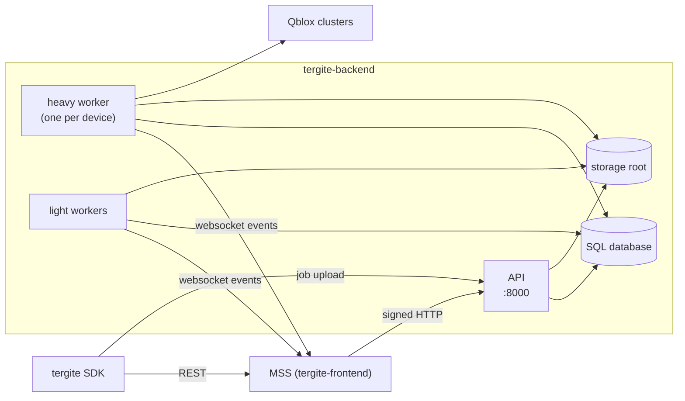
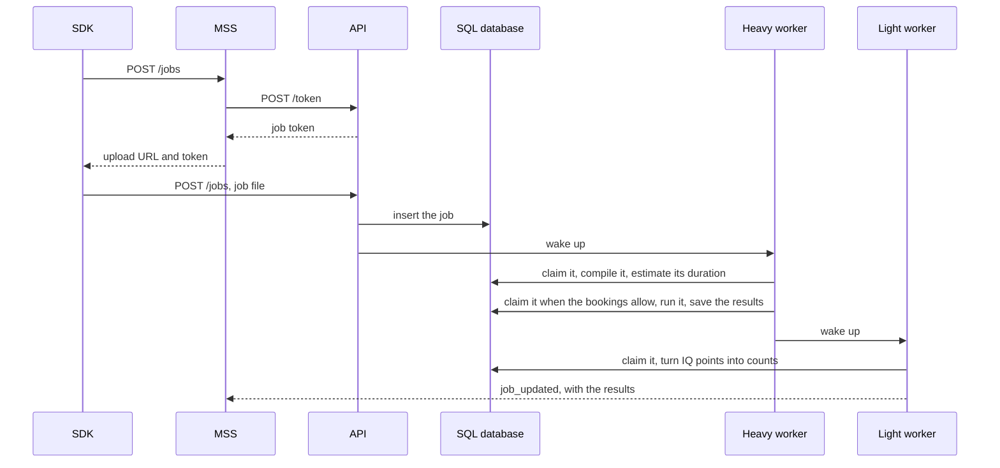

# Tergite Backend — Design

A map of the backend for contributors: what its parts are, how a job moves through them, and
where to find things in the code. Each topic links to a page in [docs/](docs) with the
details. How to set up, test and follow the code conventions is in
[CONTRIBUTING.md](CONTRIBUTING.md).

## What it is

`tergite-backend`, the Backend Control Computer (BCC), is the device-facing half of the
[Tergite stack](https://tergite.github.io/). It runs the jobs of one or more quantum devices:
real ones on Qblox clusters through [quantify](https://quantify-os.org/), or simulated ones.
Users reach it only to upload a job; everything else goes through MSS, the Main Service
Server in [tergite-frontend](https://github.com/tergite/tergite-frontend).

| Part | Path | Role |
| --- | --- | --- |
| **API** | `api/` | The FastAPI app that MSS and the SDK call: jobs, bookings, users, device properties, recalibration, switch. |
| **Workers** | `services/scheduler/` | Run each job's stages and the recalibrations, taking them from the SQL database. |
| **Executor** | `libs/quantum_executor/` | Compiles OpenQASM 3 circuits to the device's native programs and runs them. |

## How it fits in



BCC and MSS meet in three places:

1. **MSS calls BCC** over HTTP, signed with MSS's key. See [docs/auth.md](docs/auth.md).
2. **BCC tells MSS** what happened (a device started, recalibrated, a job ended) with events on
   a websocket. See [docs/mss_events.md](docs/mss_events.md).
3. **Job tokens.** MSS gets a token from BCC for each job and hands it to the user's SDK,
   which uploads the job to BCC directly with it.

## A job's journey



There is no message queue. A job is a row in the SQL `job` table, and the workers query that
table to decide what to run next, with the booking rules in the query. Workers that have
nothing to do sleep until the API or another worker wakes them with a UDP datagram.

How the stages, the booking rules, wake-ups and timeouts work:
[docs/dispatcher.md](docs/dispatcher.md). The booking rules as users see them:
[docs/booking_and_queuing.md](docs/booking_and_queuing.md).

## Code map

```
.
├── main.py              # the `bcc` command: start, serve, worker
├── settings.py          # each device's settings, read from its env file
├── api/                 # HTTP: the FastAPI app, routers, dependencies, error mapping
├── services/            # the domain
│   ├── scheduler/       # jobs, their stages, the dispatcher, recalibration
│   ├── booking/         # bookings, users, job tokens
│   ├── devices/         # device properties, calibration, switch
│   └── external/mss/    # the client to MSS, its events and signatures
├── libs/                # no app code, only utils
│   ├── quantum_executor/  # compiling and running circuits
│   ├── device_parameters/ # BackendConfig, Device, DeviceCalibration
│   └── queues/            # Job, Stage, JobStatus
├── utils/               # config, SQL, logging, errors
├── migrations/          # Alembic revisions
├── tests/
├── pkg/                 # the deb, the macOS installer, provisioning
├── docs/
└── dev/                 # start_bcc.sh, performance checks, tooling
```

### Layers

Imports run one way: `api → services → libs`, with `utils` usable by all.
`tests/test_styleguide.py` enforces this.

- A **router** resolves its dependencies, calls one or two service functions and returns the
  result. SQL, MSS's protocol and the executors live below it.
- A **service** takes the device's resources as an argument and never reaches for a global.
  This is what lets one process serve several devices, and lets tests swap the executor.
- Services raise domain errors (`utils/exc.py`), never `HTTPException`. `api/errors.py` maps
  them to status codes.

### A service's shape

| File | Contains |
| --- | --- |
| `__init__.py` | the facade: re-exports only, with `__all__`. Other code imports from here. |
| `dtos.py` | Pydantic and SQLModel models: requests, responses, tables. |
| `service.py` | the business logic, as module-level functions. |
| `store.py` | the service's tables and how it queries them. |

## Runtime

### Processes

`bcc start` runs these as child processes, and stops them all if any stops, so the service
manager restarts the backend as a whole:

| Process | Does |
| --- | --- |
| API | answers HTTP, with uvicorn |
| Heavy worker, one per device | preprocessing, execution and recalibration: the work that needs the instruments |
| Light workers | postprocessing for every device: the work that does not |

`bcc start` also kills a worker or API that is stuck, then restarts everything. See
[docs/dispatcher.md](docs/dispatcher.md#timeouts-and-stuck-processes).

### Startup

Only the *composition roots* read `settings`: the API's lifespan and dependencies
(`api/dependencies.py`) and the workers' start-up (`main.py`, `api/worker.py`). Each turns a
device's settings into a `DeviceResources` (the settings, SQL engine, job store, MSS client,
keys, executor options, and in a heavy worker the executor) and passes it down.

- The **API** creates each device's folders, migrates the database and schedules the first
  recalibration.
- A **heavy worker** also migrates (it may start first), loads the executor, saves the
  device's properties and calibration and sends them to MSS.
- Migrations run under a file lock at the storage root, so processes don't race.

### A request's path

1. `DeviceRoutingMiddleware` routes `/<device>/...` to that device; any other path goes to
   the first device.
2. `CORSMiddleware`, if a device sets `BCC_CORS_ORIGINS`.
3. `add_request_id` sets `X-Request-ID`.
4. Dependencies give the route its device's resources and check MSS's signature or the job
   token ([docs/auth.md](docs/auth.md)).
5. Error handlers turn domain errors into status codes.

## Devices

One process tree can serve several devices, one env file each. A device is named by its
`BCC_DEFAULT_PREFIX`, and everything it owns (jobs, bookings, switch, recalibrations,
executor, files) is keyed by that name. Databases may be shared between devices. How to run
several: [docs/deployment.md](docs/deployment.md#serve-several-devices-from-one-process).

## Data

**SQL** (`BCC_BOOKING_DB_URL`, SQLite by default; PostgreSQL works too):

| Table | Holds |
| --- | --- |
| `user`, `booking` | users who have booked or submitted, shared by the devices of the database, and each device's bookings |
| `job` | each device's jobs and their stages |
| `recalibration` | recalibrations done, running and due |
| `device_parameters` | each device's properties and calibration |
| `switched_off_device` | devices that are switched off |
| `mss_nonce` | MSS's request ids, against replays |
| `mss_event` | events kept while MSS was unreachable |

Alembic migrates it at start. `tests/test_migrations.py` fails if a model changed without a
revision. On SQLite the database runs in WAL mode, so it wants a local disk.

**Files**, under `<BCC_STORAGE_ROOT>/<device>/`: uploaded and preprocessed job files and the
results (as HDF5), kept until their job is deleted or expires, the executor's data and lock,
the workers' wake-up port files and the job supervisor log.

**Configuration**: each device's env file and the files it names. See
[docs/configuration.md](docs/configuration.md).

## Known rough edges

- **MSS learns late what happened while it was unreachable.** Kept events reach it once it is
  back. A switch made in the meantime reaches it only when switched again.
- **A worker run alone is watched only by systemd.** Outside a unit with `WatchdogSec`,
  nothing restarts a stuck `bcc worker` or `bcc serve`.
- **Nothing ages a waiting job.** Outside bookings, a long job waits while shorter ones
  overtake it, until `BCC_MAX_EXECUTION_QUEUE_TIME` (a day) fails it.

## Further reading

| Page | For |
| --- | --- |
| [docs/dispatcher.md](docs/dispatcher.md) | how jobs move through the workers: stages, booking rules, wake-ups, timeouts, recalibration |
| [docs/mss_events.md](docs/mss_events.md) | the websocket events to MSS, retries, outages, changing their schema |
| [docs/auth.md](docs/auth.md) | signatures, job tokens, and who may call which endpoint |
| [docs/executors.md](docs/executors.md) | compiling and running circuits, pulse-level jobs, the simulated chip, adding an executor |
| [docs/how_circuits_run.md](docs/how_circuits_run.md) | what the backend does to a circuit that can change its results |
| [docs/booking_and_queuing.md](docs/booking_and_queuing.md) | bookings and queueing as users see them |
| [docs/configuration.md](docs/configuration.md) | the config files, simulated devices |
| [docs/deployment.md](docs/deployment.md) | installing and running as a service |
