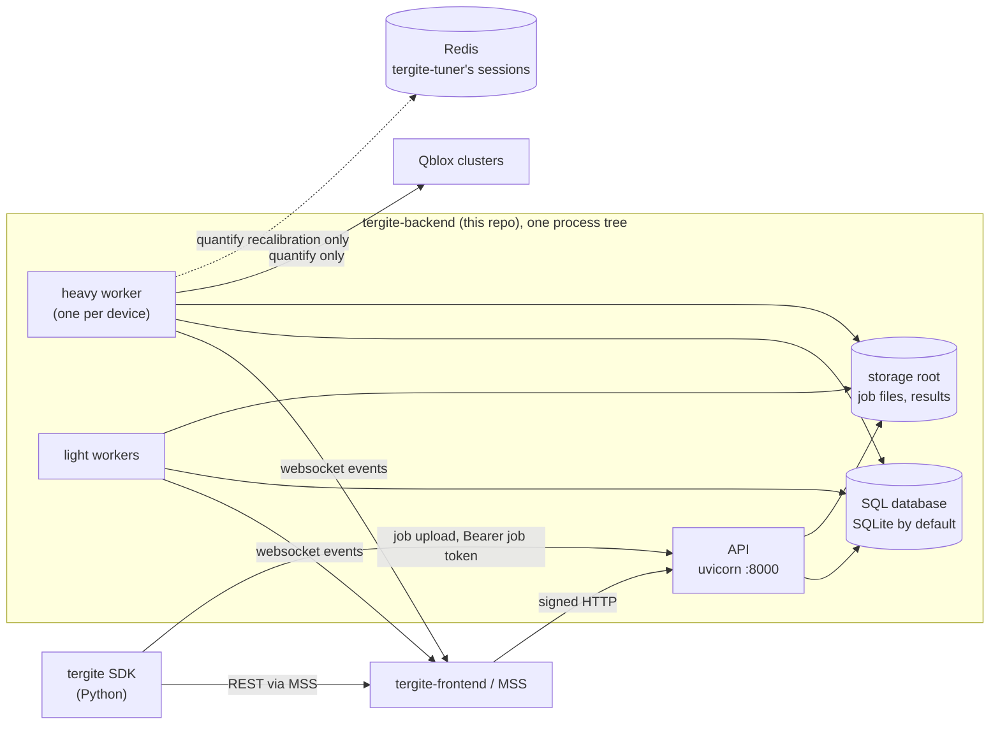
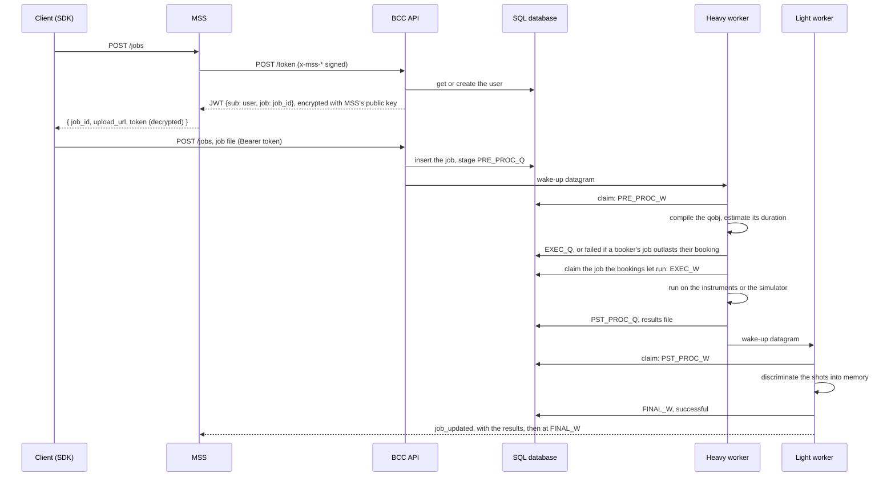
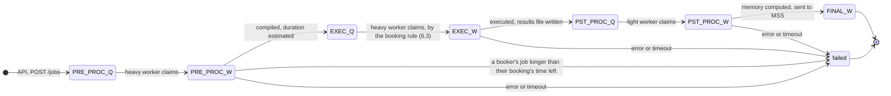
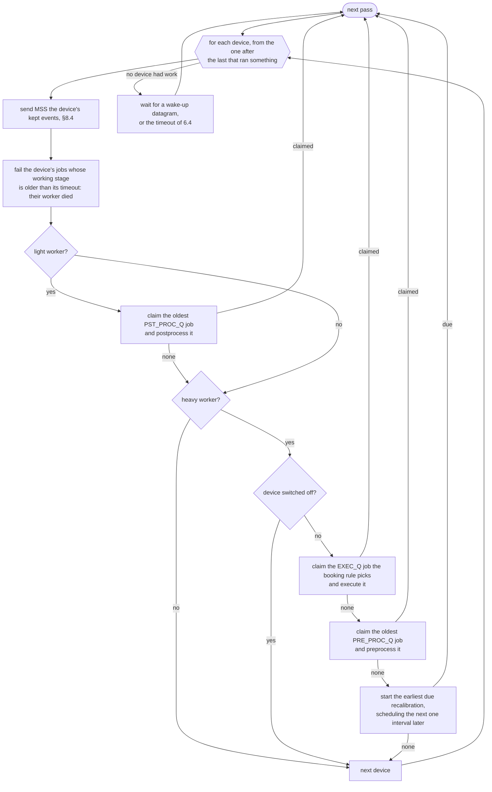
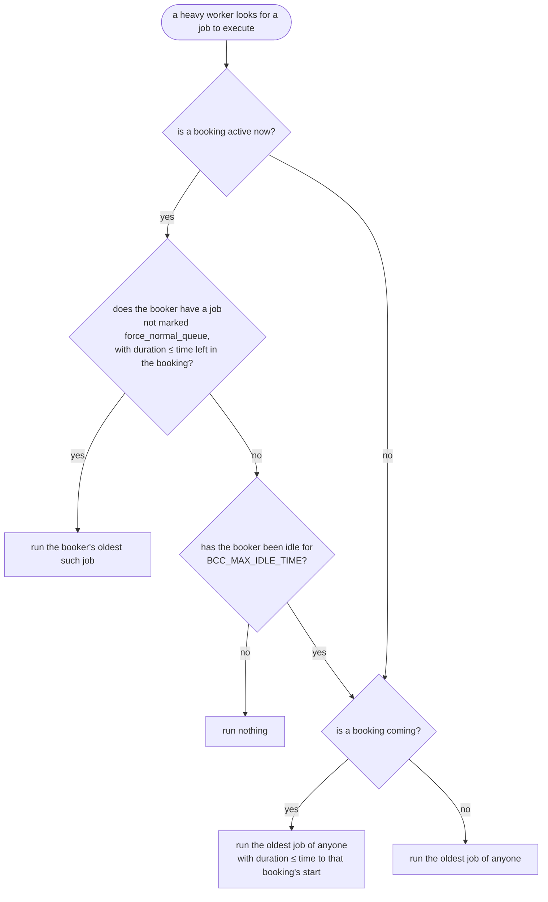
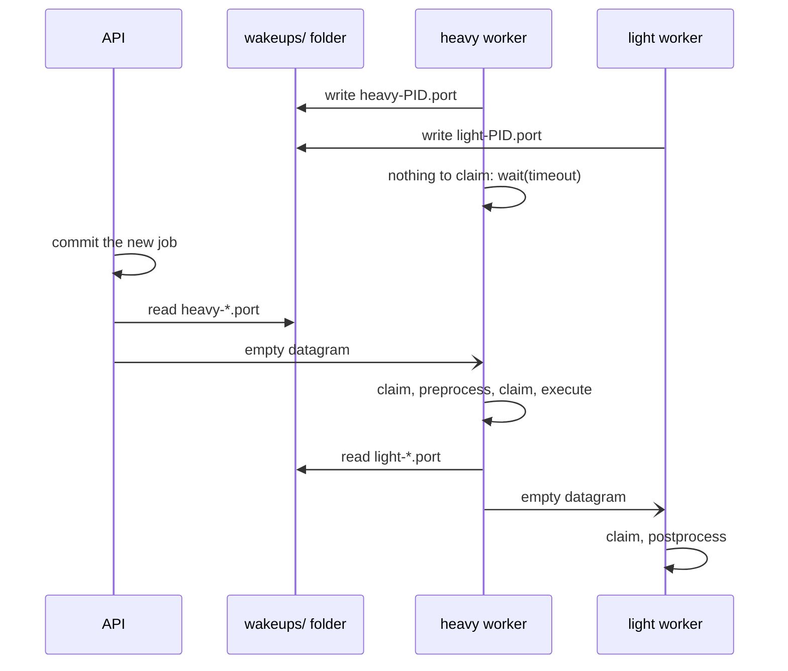
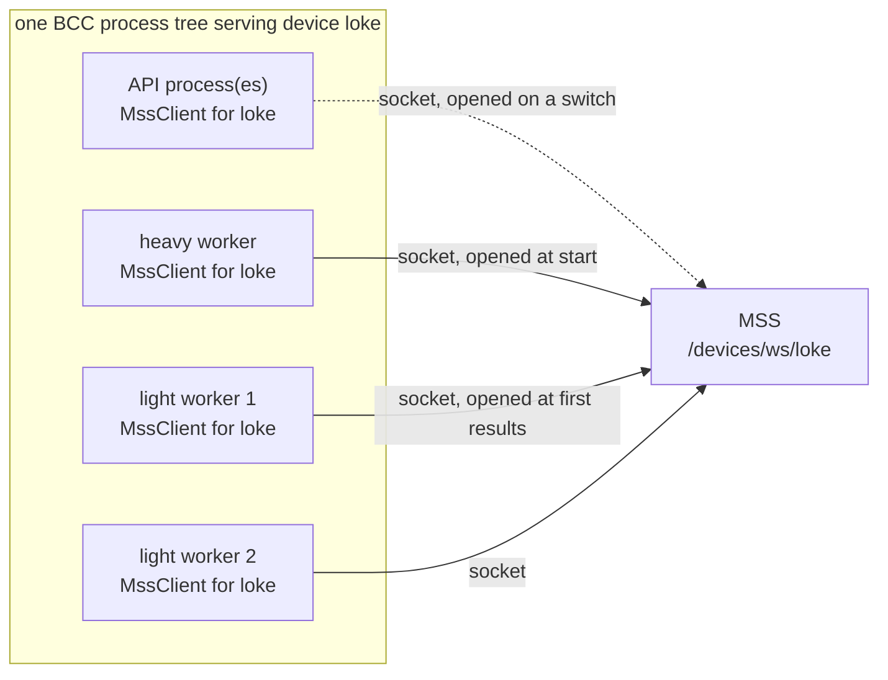
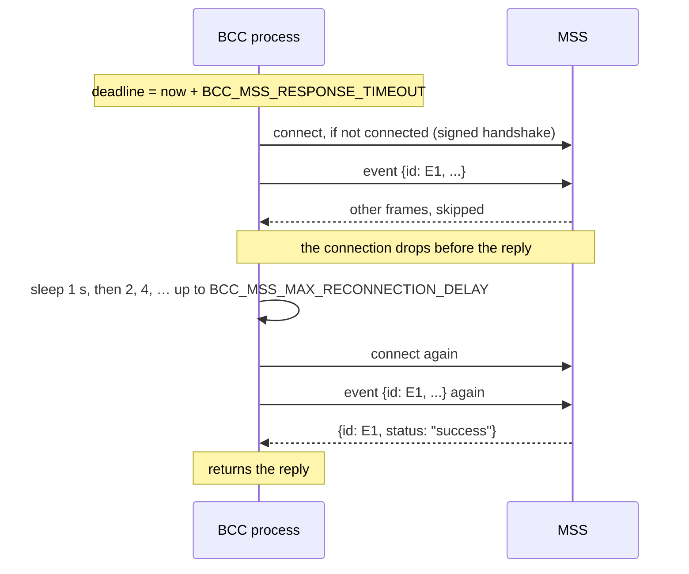
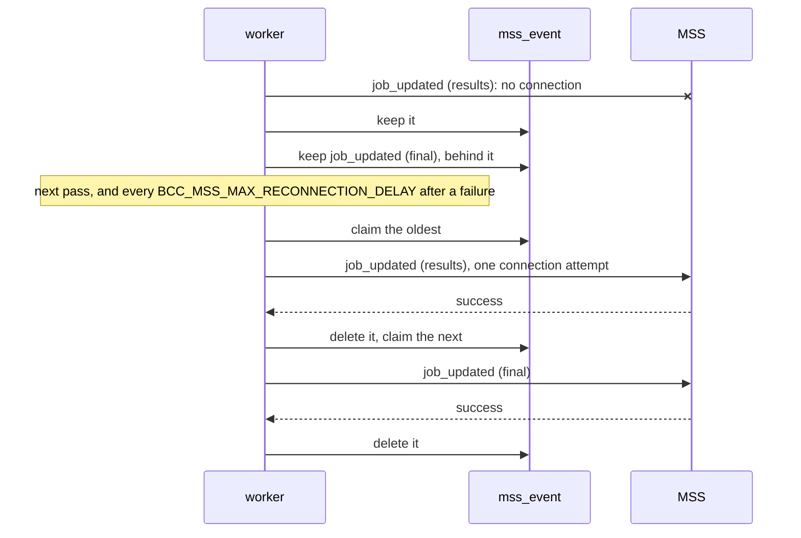

# Tergite Backend — System Design

This document describes the architecture of `tergite-backend`, the Backend Control Computer
(BCC): what it is, how it sits beside MSS, how a request and a job move through it, how it keeps
its devices apart, where it stores what, how it is configured, deployed and tested, and the
conventions a contributor is expected to follow. The narrower docs —
[docs/auth.md](docs/auth.md), [docs/booking_and_queuing.md](docs/booking_and_queuing.md),
[docs/configuration.md](docs/configuration.md), [docs/executors.md](docs/executors.md) — remain
the reference for the signatures, the booking rules, the config files and adding an executor;
this document is the map that ties them together.

## 1. What this repo is

`tergite-backend` is the device-facing half of the [Tergite stack](https://tergite.github.io/)
for the WACQT quantum computers. A BCC runs the jobs of one or more quantum devices: real
devices through Qblox clusters with [quantify](https://quantify-os.org/), or simulated ones
with [qiskit-dynamics](https://qiskit-community.github.io/qiskit-dynamics/). Users never reach
it directly except to upload a job: everything else comes through MSS, the Main Service Server
in [tergite-frontend](https://github.com/tergite/tergite-frontend).

| Part | Path | Stack | Role |
| --- | --- | --- | --- |
| **API** | `api/` | Python 3.13+, FastAPI, uvicorn | The REST API MSS and the SDK call: jobs, bookings, users, the device's properties, recalibration and switch. |
| **Workers** | `services/scheduler/` | the same process image, `main.py worker` | Run each job's stages and the recalibrations, claiming them from the SQL database. |
| **Executors** | `libs/quantum_executor/` | quantify-scheduler and Qblox, or qiskit-dynamics and JAX | Compile OpenPulse jobs to the device's native programs and run them. |

The two executors' dependencies conflict, so an installation carries one: the `quantify` extra,
packaged as `tergite-backend`, or the `qiskit` extra, packaged as `tergite-backend-simulator`.

## 2. System context



The API and the workers share no memory: they meet in the SQL database and the storage root,
and the API and the heavy worker wake the others over the loopback (§6). Redis is needed only
by the quantify executor, whose tergite-tuner keeps its sessions there (`BCC_TUNER_REDIS_URL`);
the simulators run without it.

## 3. BCC and MSS: the seam between them

### 3.1 Contract

BCC depends on MSS only through:

1. **Signed HTTP calls from MSS** — every route but the job upload and the log download checks
   MSS's `x-mss-*` headers: a signature over the user, nonce, timestamp, admin flag, method and
   path, verified with MSS's public key (`BCC_MSS_PUBLIC_KEY_PATH`), a timestamp no older than
   `BCC_MSS_NONCE_TTL`, and a nonce not claimed before. See `get_verified_mss_user_id` in
   [api/dependencies.py](api/dependencies.py) and [docs/auth.md](docs/auth.md).
2. **Websocket events to MSS** — the workers report on `BCC_MSS_DEVICE_EVENTS_ENDPOINT`
   (`/devices/ws/{device}` on MSS): `initialized` with the device's properties and calibration,
   `recalibrated`, `job_updated` when a job fails, gets its results and ends (§6.1),
   `switched_off` and `switched_on`. The
   connection is signed with BCC's private key (`BCC_PRIVATE_KEY_FILE`); MSS replies to each
   event by its id. See `MssClient` in
   [services/external/mss/service.py](services/external/mss/service.py) (§8).
3. **Job tokens** — `POST /token` gives MSS a JWT for one user and one job, encrypted with
   MSS's public key; MSS hands it, decrypted, to the user's SDK, which uploads the job with it.

MSS keeps users, projects, QPU seconds and the job's record; BCC keeps the bookings, its own
copy of the users who have booked or submitted, the jobs it runs and the device's parameters.

### 3.2 Job submission — the one flow that crosses everything



The upload is the only call a user makes to BCC, which is why it alone takes the job token
instead of MSS's headers; the token names one job, and the upload is refused if the file's
`job_id` is another, or that job exists already.

## 4. Architecture: layered

BCC is organised in layers, each importing only those below it: `api → services → libs`, with
`utils` beside them for what every layer uses. `settings` is read only by the composition
roots (§5.2). `tests/test_styleguide.py` checks the direction.

```
.
├── main.py                  # the command line: start (the API and the workers), serve, worker
├── settings.py              # each device's settings, from its env file; the composition roots read it
├── api/                     # the HTTP adapter
│   ├── __init__.py          # the FastAPI app: CORS, request id, error handlers, routers
│   ├── dependencies.py      # the lifespan, MSS's signature check, the job token, DeviceResourcesDep
│   ├── device_routing.py    # DeviceRoutingMiddleware: /<device>/... to that device
│   ├── errors.py            # each domain error's status code
│   ├── middleware.py        # the x-request-id header
│   ├── worker.py            # what a worker loads before it runs: the device's resources, its executor
│   └── routers/             # bookings, devices, jobs, logfiles, recalibration, switch, users
├── services/                # the domain
│   ├── scheduler/           # jobs, their stages, the dispatcher, the workers' wake-ups, recalibration
│   ├── booking/             # bookings and users, and the job tokens
│   ├── devices/             # the device's properties, calibration and switch
│   └── external/mss/        # the client to MSS, its events, signatures and nonces
├── libs/                    # imports no app code but utils
│   ├── quantum_executor/    # base/, quantify/, qiskit/: compiling and running the jobs
│   ├── device_parameters/   # BackendConfig, Device, DeviceCalibration
│   ├── queues/              # Job, Stage, JobStatus, ExecutorOptions
│   ├── qiskit/              # qiskit's Pulse Qobj, vendored as qiskit 1.x dropped it
│   └── qiskit_providers/    # qiskit's JSON encoder and decoder, vendored likewise
├── utils/                   # config, SQL, logging, datetimes, exceptions, strings
├── migrations/              # Alembic's revisions of the SQL database
├── tests/
├── pkg/                     # the deb, the macOS installer, the service files, provisioning
├── docs/                    # the narrower docs above, and the device schema
└── dev/                     # start_bcc.sh, and perf/: the performance check
```

### The shape of a service

A service is a package whose `__init__.py` is its facade: it only re-exports, with `__all__` as
strings. Code outside the service imports from the facade (`from services.scheduler import
DeviceResources`), never from its modules; `tests/test_styleguide.py` checks this.

| File | Contains |
| --- | --- |
| `dtos.py` | Pydantic and SQLModel models: request bodies, responses, and tables. |
| `service.py` | The business logic: module-level functions taking the device's `DeviceResources`, or the SQL engine, first. |
| `store.py` | The service's tables, where it keeps its own: `JobsStore`, the device parameters. |

### Why the layering matters

A router should read as: resolve dependencies → call one or two service functions → return the
result. SQL, MSS's protocol and the executors live below it.

- Services take the device's resources as an argument; they never reach for a global. This is
  what lets one process serve several devices, and the tests swap a device's executor.
- `services/` may import `libs/`, `utils/` and other services; it must not import `api/` or
  `settings`. `libs/` imports only `utils/`.
- Only the composition roots read `settings`, and they turn each device's settings into a
  `DeviceResources` before handing it on (§5.2).

## 5. Runtime

### 5.1 Processes

`main.py start`, the default command, runs as child processes the API, a heavy worker for each
device and `--light-workers` light workers (default 1), and stops them all when any stops, so
that the service manager restarts the backend whole. `serve` and `worker --kind heavy|light`
run one alone. The children start the platform's way, as macOS cannot fork a process that has
loaded its frameworks. `start` also kills a worker that is past its deadline, as stuck (§6.5),
which stops the rest the same way.

| Process | Runs |
| --- | --- |
| API (`serve`) | uvicorn, with `--workers` processes; answers HTTP. |
| Heavy worker | one device's preprocessing, executions and recalibrations: the work that needs its executor. |
| Light worker | every device's postprocessing: the work that needs no instruments. |

### 5.2 Startup

The composition roots are the API's lifespan and dependencies, in
[api/dependencies.py](api/dependencies.py), and the workers' start-up, `_run_worker` in
`main.py` with [api/worker.py](api/worker.py). Each gets, per device, a `DeviceResources`: the
settings, the SQL engine, the `JobsStore`, the `MssClient`, the keys, the executor options and
lock, and, in a heavy worker, the executor.

- The **API's lifespan** creates each device's folders, then, under the file lock
  `<storage root>/.start-up.lock`, migrates its database with Alembic and schedules its
  recalibration. On shutdown it stops the recalibrations and closes the resources.
- A **worker** migrates under the same lock, as it may start before the API. A heavy worker
  loads the executor, whose instruments it resets; the executor may refine the backend config
  (the simulators train their discriminators), so the heavy worker alone saves the device's
  properties and calibration in the database and sends them to MSS as `initialized`.

### 5.3 Per-request pipeline

1. **`DeviceRoutingMiddleware`** — the outermost. A path whose first segment names a device
   (`/loke/bookings`) runs as that device, the segment moved into the root path as Starlette's
   `Mount` does; any other path runs as the first device. It puts the name on `request.state`.
2. **`CORSMiddleware`** — only when some device sets `BCC_CORS_ORIGINS`.
3. **`add_request_id`** — echoes MSS's `x-mss-request-id`, or a new id, as `X-Request-ID`.
4. **Dependencies** — `DeviceResourcesDep` gives the route the resources of its device.
   `get_verified_mss_user_id` and `get_verified_mss_admin_user_id` check MSS's headers,
   `get_mss_token_claims_dep` the job token, and `check_device_is_online` refuses a switched-off
   device with 503.
5. **Error handlers** — `api/errors.py` maps the domain errors of `utils/exc.py` to status
   codes once: `NotAuthenticatedError` → 401, `UnauthorizedError` → 403, `ItemNotFoundError` →
   404, `ConflictError` → 409, the booking errors → 400 or 422, `IsOfflineError` → 503,
   `MssRejectedError` → 502, `MssTimeoutError` → 504, and `ValueError`, `TypeError` and the like
   → 500 with a generic message. **Raise domain errors from services; never `HTTPException`.**

## 6. Queueing: the dispatcher

BCC has no queue. A job waits as a row of the SQL `job` table, and the workers decide what runs
next by querying that table at the moment they look, with the bookings' rules in the query.
RQ's queues did this before, with a waitlist and timers beside them, as a first-in-first-out
queue cannot say "the booker's oldest job that fits what is left of their booking". The code is [services/scheduler/dispatcher.py](services/scheduler/dispatcher.py);
the user-facing rules are in [docs/booking_and_queuing.md](docs/booking_and_queuing.md).

### 6.1 A job's stages

A job's row holds the job as JSON (`data`) and the columns the dispatcher queries: `stage`,
`status`, `user_id`, `created_at` (submission time, the queues' order), `estimated_duration`,
`claimed_at`, `executed_at`, `is_booking_excluded` and `results_file`. Each stage has a queued
step (`_Q`), which a claim takes, and a working step (`_W`), which the claim gives it.



| Stage | Status MSS sees | Moved on by |
| --- | --- | --- |
| `PRE_PROC_Q` | `pending` | the API, which inserts the job and wakes the device's heavy workers |
| `PRE_PROC_W` | `executing` | a heavy worker's claim; it compiles the job under the executor lock and records `estimated_duration` |
| `EXEC_Q` | `pending` | the same worker, at once, unless the job is a booker's that is too long for their booking's time left, which it fails |
| `EXEC_W` | `executing` | a heavy worker's claim; it runs the job under the executor lock |
| `PST_PROC_Q` | `executing` | the same worker, with `executed_at` and `results_file`; it wakes the light workers |
| `PST_PROC_W` | `executing`, then `successful` | a light worker's claim; it moves the results to `logfile_download_pool`, computes the memory, marks the job `successful` and sends MSS `job_updated` with it |
| `FINAL_Q` → `FINAL_W` | `successful` | the same worker, which sends MSS `job_updated` again |

`REG_Q` and `REG_W` are no longer used: a job starts at `PRE_PROC_Q`. A job that fails at any
stage is marked `failed` with its reason, logged to the job supervisor log, and sent to MSS as
`job_updated`. Those are the only `job_updated` events: the stages in between are not reported.

### 6.2 A worker's loop

`Dispatcher.run` loops over the worker's devices, in the order the env files gave them. For
each device it runs `_run_once`; as soon as one device runs something, the next pass starts
from the device after it, so that a light worker, which serves every device, takes them in
turn. Only when no device had anything does it wait.



So a heavy worker prefers executing to preprocessing, and preprocessing to recalibrating: a
recalibration runs only when its device has no job it may execute and none to preprocess.
While a device is switched off its heavy work stops, but its jobs still postprocess.

**A claim** is one transaction (`_claim_job`): it picks the row, sets its `stage` to the
working step and `claimed_at` to now, and commits. `open_immediate_session` begins it with
SQLite's write lock (`BEGIN IMMEDIATE`), so no other process's claim can read the same row as
waiting; on PostgreSQL the `SELECT … FOR UPDATE SKIP LOCKED` does the same. The worker then
runs the stage outside the transaction.

### 6.3 Which job executes next

`_pick_next_execution` chooses among the device's `EXEC_Q` jobs that are not cancelled or
failed, oldest first. Every job there has its `estimated_duration` from preprocessing.



- **Idle** is measured from the later of the booking's start and the end of the booker's last
  execution in it (`executed_at`); while a job of the booker's executes, they are not idle.
- **Others' jobs during a booking** run only once the booker is idle, one at a time, each
  checked again before it starts; they must end before the *next* booking starts, not before
  the current one ends, and one under way when the booker submits again runs to completion.
- **Outside bookings**, a job longer than the time to the next booking waits, and shorter, newer
  jobs overtake it until it fits. Nothing ages a waiting job, so a long job waits as long as
  bookings keep leaving too little room, until `BCC_MAX_EXECUTION_QUEUE_TIME` (§6.5) fails it.
- **`force_normal_queue=true`** on `POST /jobs` sets `is_booking_excluded`: the booker's job is
  treated as anyone's, and is not failed for being too long for their booking.
- **Too long for the booking**: when preprocessing ends (`mark_preprocessed`), a job of the
  active booking's booker, not marked `force_normal_queue`, whose `estimated_duration` exceeds
  the booking's time left is failed at once, so that the booker can choose to book longer or
  resubmit with `force_normal_queue`. A booker's job preprocessed before their booking starts is
  not checked; if it does not fit once the booking is active, it waits like anyone's.
- A job under way when its booking ends runs to completion.

### 6.4 Waking the workers

A worker with nothing to do blocks in `WakeUpListener.wait(timeout)`, a `select` on a UDP socket
bound to a free port of `127.0.0.1`, which it names in each of its devices' folders as
`<storage root>/<device>/wakeups/<kind>-<pid>.port` (a worker of both kinds writes two files).
The wait ends on the first datagram or the timeout, and drains every datagram that came, so
that a burst of wake-ups costs one pass.



**Who sends one** (`wake_workers(device, kind)`), always after committing the change:

| Event | Sender | Wakes |
| --- | --- | --- |
| a job submitted | API | heavy |
| a booking created or cancelled | API | heavy |
| a user's profile deleted, cancelling their jobs and bookings | API | heavy |
| a recalibration scheduled, at API start or by `/recalibration/init` | API | heavy |
| a device switched on | API | heavy |
| a job executed | heavy worker | light |

Cancelling a job wakes no one: it adds no work. A heavy worker that has just preprocessed needs
no wake-up either, as it loops on at once.

**The timeout** (`Dispatcher._get_wait_seconds`) is computed by the worker itself, as nothing
sends a datagram when time passes:

- A light worker always waits at most `BCC_MAX_WORKER_WAIT_TIME`, 5 s by default, the shortest
  of its devices'.
- A heavy worker, for each of its devices that has a job in `EXEC_Q`, takes the earliest of
  these that is still in the future (`get_next_change_at`): the active booking's end; the
  moment its booker becomes idle (their last activity plus `BCC_MAX_IDLE_TIME`); the next
  booking's start. It waits until the earliest over its devices, but at most
  `BCC_MAX_WORKER_WAIT_TIME`.

These are the moments the booking rule of 6.3 can start to pick a different job, so a waiting
job starts on time instead of up to `BCC_MAX_WORKER_WAIT_TIME` late. That cap bounds everything
nothing announces:
a due recalibration, a dead worker's job reaching its timeout, and a lost datagram (a port
file read half written costs that worker its timeout).

A worker deletes the port files of dead processes as it starts, and its own as it stops;
`Dispatcher.stop`, which SIGTERM calls, sends the worker a datagram, so it stops after the
stage under way without waiting out its timeout.

### 6.5 Timeouts, cancellation and recalibration

- **A stage's time limit**: preprocessing, execution and postprocessing run under a `SIGALRM`
  timer of `BCC_MAX_PREPROCESSING_TIME`, `BCC_MAX_EXECUTION_TIME` and
  `BCC_MAX_POSTPROCESSING_TIME` (`_raise_after`, which acts only in the main thread). A stage
  past it fails its job: preprocessing and execution as "timed out", postprocessing as "error
  during post processing". 0 means no limit.
- **A stuck worker**: a stage's `SIGALRM` interrupts it only once Python code runs again, so a
  worker stuck in a call that never returns, in an instrument driver or a simulation, would stay
  stuck. Each worker therefore sets itself a deadline (`WorkerDeadline`, shared memory on the
  monotonic clock) as it goes: before a stage, its time limit plus `BCC_MSS_RESPONSE_TIMEOUT`,
  for telling MSS of it, plus a minute (`_DEADLINE_MARGIN_SECONDS`), or none for a stage without
  a limit; at the start of a pass, `BCC_MSS_RESPONSE_TIMEOUT` plus the minute; before a wait,
  the wait plus the minute. Before its first pass, as it connects to the clusters and loads its
  executor, it has the one `bcc start` sets as it starts it, `BCC_MAX_WORKER_START_TIME`, 10
  minutes by default, the longest of its devices'. `bcc start` checks every worker's deadline every 5 s
  (`DEADLINE_CHECK_SECONDS` in `main.py`), and kills, with `SIGKILL`, as its `SIGTERM` handler
  could not run, a worker past it; then it stops the rest, and the service manager restarts the
  backend. The killed worker's job is then failed as overdue.
- **A job that waits too long to execute**: every pass also fails the device's jobs in
  `EXEC_Q` last written longer ago than `BCC_MAX_EXECUTION_QUEUE_TIME`, a day by default, 0 for
  no limit (`fail_jobs_queued_too_long`), with the reason that they waited that long, and tells
  MSS. Nothing writes a job waiting there before its claim, so that is when it was preprocessed.
- **A dead worker's job**: every pass starts with `fail_overdue_jobs`, which fails the device's
  jobs whose working stage was claimed longer ago than that stage's limit, as the worker that
  claimed them can no longer be running it. Whichever worker looks first does it.
- **Cancelling** a job sets its status to `cancelled`, which every claim's query excludes, so no
  worker claims it again. A stage already running finishes, its status staying `cancelled`; an
  execution's results are then dropped, so the job never reaches postprocessing.
- **Deleting** a job cancels it if it has not ended, then deletes its row.
- **Recalibration** is a `recalibration` row: `scheduled` with a `due_at`, then `started`, then
  `finished` or `failed`. Scheduling one deletes the device's scheduled rows and stops the one
  under way from repeating, then inserts a new one, due now unless given a time, repeating every
  `BCC_DEFAULT_RECALIBRATION_INTERVAL` unless given an interval; the API does this at every
  start. A heavy worker starts the earliest due row in one transaction, inserting the next one
  interval later, then runs it under the executor lock and `BCC_MAX_RECALIBRATION_QUEUE_TIME`.
  The calibration it finds, quantify's alone, is saved as the device's, which the light
  workers discriminate with and `/dynamic-properties` serves, and sent to MSS; the executor
  takes its frequencies for the jobs after it, and the seed file keeps it for a restart.
  A heavy worker starting fails the device's rows left `started` by one that stopped before
  they ended (`fail_abandoned_recalibrations`), unless the executor lock is held, as by a
  recalibration another heavy worker is running.
- **The executor lock**, a file lock in the device's `executor_data` folder, keeps
  preprocessing, executions and recalibrations of a device from running at once on its
  instruments, should two heavy workers serve it.
- **Expiry**: a job's row is deleted `BCC_JOBS_STORE_TTL` seconds after it was last written,
  when another job is inserted.

## 7. Authentication and authorization

BCC has no login of its own: MSS authenticates users, and BCC trusts MSS's signature.

- **MSS's headers** carry the user (`x-mss-user-id`) and whether MSS holds them an admin
  (`x-mss-is-admin`), both under MSS's signature. Admin-only routes —
  creating, listing and deleting users, recalibration, the switch — use
  `get_verified_mss_admin_user_id`.
- **Nonces** are claimed in the `mss_nonce` table, for `BCC_MSS_NONCE_TTL` seconds, before the
  route runs, so a request cannot be replayed while in flight, nor after a restart.
- **Job tokens** are HS256 JWTs signed with `BCC_JWT_SECRET`, with the user as `sub` and the job
  as `job`, expiring after `BCC_JWT_TTL`. They upload a job, cancel it, and download its log
  file (`/logfiles/{job_id}`).
- A user is an owner or an admin: a job or booking's routes check that the user owns it, or is
  an admin of MSS or of BCC.

### Endpoint map

Every path below may be prefixed with a device's name (`/loke/jobs`); without one it reaches
the first device.

| Path | Auth | Notes |
| --- | --- | --- |
| `GET /` | MSS | a greeting, for MSS to check the signature |
| `/static-properties`, `/dynamic-properties` | MSS | the device's properties and calibration, as the heavy worker saved them |
| `POST /token` | MSS | a job token, encrypted with MSS's public key; creates the user if new |
| `/me` | MSS | `GET` the user's profile; `DELETE` it, cancelling their jobs and bookings |
| `/users`, `/users/{user_id}` | MSS admin | create, list, delete |
| `/bookings` | MSS | create, list, `/{booking_id}/cancel`, `/config` |
| `/jobs` | job token / MSS | `POST` uploads (token); `GET` lists, `GET /{job_id}`, `DELETE /{job_id}` (MSS); `/{job_id}/cancel` (either) |
| `/logfiles/{job_id}` | job token | the job's results, as HDF5 |
| `/recalibration` | MSS admin | `/init`, `/info`, `/cancel` |
| `/switch` | MSS admin / MSS | `/off`, `/on`; `/status` |

Interactive docs are at `/docs`.

## 8. Talking to MSS

BCC talks to MSS on two channels, one each way. MSS calls BCC over HTTP, signed (§3.1, §7).
BCC tells MSS what happened over a websocket of MSS's, `/devices/ws/{device}`, which this
section describes. The code is [services/external/mss/](services/external/mss).

### 8.1 The connections



- **One socket per device per process.** Every process builds a `DeviceResources` for each of
  its devices, and with it an `MssClient`. So the API (each of its `--workers` processes), the
  heavy worker and every light worker each hold their own socket for a device. MSS keeps them
  all in a list; they do not displace each other.
- **Opened lazily.** A client connects when it first sends: the heavy worker at start, a light
  worker at its first results, the API at its first switch. The library pings every 20 s and
  drops a connection whose ping goes unanswered for 20 s; the next event reconnects. The
  resources close it at shutdown.
- **The URL** is `BCC_MSS_DEVICE_EVENTS_ENDPOINT`, by default `ws://` (or `wss://` for an
  `https` MSS) on `BCC_MSS_MACHINE_ROOT_URL`'s host and port, path `/devices/ws/<prefix>`.
- **The handshake** carries `x-id` (the device's name), `x-request-id` (a fresh UUID),
  `x-timestamp` and `x-signature`, BCC's private key's signature of
  `<x-id>-<x-request-id>-<x-timestamp>`. MSS checks it against the backend's `public_key_path`,
  checks the source IP unless the backend's `is_strict_ip` is false, rejects a timestamp older
  than its `bcc_nonce_ttl` and a request id seen before, and refuses a path naming another
  device. A refused handshake counts as a failed connection attempt (8.3).
- **Online and offline in MSS.** MSS keeps each socket as a connection in its database, which
  the MSS process holding it renews every 30 s and which lapses 90 s after it stops. A device is
  online while any of its connections is live, whichever MSS process holds it, and it is not
  switched off; a backend or MSS process that dies without closing its sockets leaves the device
  offline within 90 s. See tergite-frontend's DESIGN.md §7.
- **One way.** MSS never sends BCC requests on the socket; it only answers BCC's events. BCC
  reads nothing but the reply to the event it sent.

### 8.2 The messages

Each event is one JSON text frame, `{"id": <uuid>, "name": <event>, "data": <object>}`
(`DeviceEvent`), which `DeviceEvent` validates: `data` must be the type its `name` expects. MSS
answers each with `{"id": <the event's id>, "status": "success" | "error", "detail": <reason>}`.
A frame that fails MSS's validation, or names another device's record, gets an `error` reply;
the socket stays open.

| Event | `data` | Sent by | When |
| --- | --- | --- | --- |
| `initialized` | `Device`: the device's properties | heavy worker | at start, after loading the executor |
| `recalibrated` | `DeviceCalibration` | heavy worker | at start, right after `initialized`; after each recalibration that returns one (quantify only) |
| `job_updated` | `Job`, whole | the worker running the job | when it fails; when postprocessing has its results; at `FINAL_W` (§6.1) |
| `switched_off` | `{"date"}` | API | on `POST /switch/off`, after recording it |
| `switched_on` | `{"date"}` | API | on `POST /switch/on`, after recording it |

### 8.3 Sending an event

`MssClient.send_event` sends and waits for the reply as one operation, so that a reply lost
with a dropped connection makes it send again:



- **The deadline** is `BCC_MSS_RESPONSE_TIMEOUT` (120 s) from the first send, for the whole
  operation; each wait for the reply gets only what is left of it.
- **Connection attempts** are at most `BCC_MSS_CONNECTION_MAX_ATTEMPTS` + 1 (6) per event, each
  opening within `BCC_MSS_CONNECTION_TIMEOUT` (5 s).
- **Errors**: past the deadline, or out of attempts, `MssTimeoutError`; a reply whose status is
  not `success`, `MssRejectedError`.
- **At least once.** If MSS handled an event but its reply was lost with the connection, BCC
  sends the event again, with the same id, so MSS can receive one twice. Each event carries the
  whole job, device or calibration, so handling it twice leaves the same state.
- **Order** is kept within a process, which sends one event at a time and waits for its reply;
  there is none across processes.
- **Blocking.** The sending worker or route waits for the reply, up to the deadline.

### 8.4 When MSS cannot be reached

The workers keep what MSS cannot take, so that neither a job nor a worker depends on MSS
answering (`send_mss_event`, in
[services/external/mss/events.py](services/external/mss/events.py)):

- **An event MSS cannot be reached for**, once its sending has run out of time or connection
  attempts (8.3), is kept as a row of the `mss_event` table, and the worker goes on: the job's
  state in BCC is what it was, and the worker stays up.
- **While events of a device are kept**, a new one is kept behind them without being sent, so
  that MSS gets the device's events in the order they happened, and only the first event of an
  outage waits on MSS.
- **Each pass of a worker's loop** (§6.2) first sends its devices' kept events, oldest first,
  trying a single connection; after a failure it waits `BCC_MSS_MAX_RECONNECTION_DELAY` before
  trying again. A process claims an event while it sends it, so that two processes do not send
  one twice, and a claim older than twice `BCC_MSS_RESPONSE_TIMEOUT`, its sender dead, lapses.
- **An event MSS refuses** is logged and dropped, as sending it again would not change MSS's
  answer.
- **A switch** is the exception: the API sends it directly, as it is answering MSS's own call;
  the switch is recorded, and the route answers 504.



## 9. Devices

One process tree serves the devices of its env files: `main.py start --env-file loke.env
--env-file thor.env`, or `BCC_ENV_FILE` naming them separated as in `PATH`. A device is named
by its `BCC_DEFAULT_PREFIX`. Whatever a device owns — its jobs, bookings, switch, recalibration
schedule, executor and lock, files — is keyed by or held for that device, never shared by
accident of a common database or folder.

- **Settings** (`utils/config.py`'s `DeviceSettings`): a device's `BCC_<PREFIX>_<NAME>`
  variables override `BCC_<NAME>` from the environment, which overrides the env file's.
- **Routing**: the API serves each device under `/<prefix>/...` (§5.3).
- **Workers**: each device gets a heavy worker; the light workers postprocess every device's
  jobs.
- **Databases** may be shared: the `job` table is keyed by device and job, and the others carry
  the device's name where they need it.

## 10. Data

### SQL

The SQL database at `BCC_BOOKING_DB_URL` (SQLite by default) holds, as SQLModel tables:

| Table | Holds |
| --- | --- |
| `user`, `booking` | the users who have booked or submitted, and their bookings |
| `job` | each device's jobs: the job's JSON, its stage, the dispatcher's columns; a job expires `BCC_JOBS_STORE_TTL` seconds after it was last written |
| `recalibration` | each device's recalibrations: done, under way and due |
| `device_parameters` | the backend's device info and calibration, which the heavy worker saves |
| `switched_off_device` | a device switched off, until it is switched on |
| `mss_nonce` | MSS's nonces, until they expire |
| `mss_event` | the events MSS could not be reached for, until a worker has sent them (§8.4) |

Every process makes its own engine, which pools its connections, and on SQLite writes ahead to a
log (`journal_mode=WAL`, `synchronous=NORMAL`), so that a commit, as of each request's nonce,
does not wait for a full sync, and reads go on while another process writes; the database
keeps `-wal` and `-shm` files beside it, and wants a local disk.

Alembic migrates it ([migrations/](migrations)): the API and the workers both migrate at start,
under the start-up lock, and `tests/test_migrations.py` fails when a model changed without a
revision.

### Files

Under `<BCC_STORAGE_ROOT>/<prefix>/`: the uploaded job files (`job_upload_pool`), the
preprocessed ones (`job_preproc_pool`), the executor's experiment folders and lock
(`executor_data`), the wake-up port files (`wakeups`), the results the log route serves
(`logfile_download_pool`, as HDF5) and the job supervisor log. `BCC_STORAGE_PREFIX_DIRNAME`
lets devices share the folder of uploads, results and log. The start-up lock sits at the
storage root.

## 11. Executors

A `QuantumExecutor` ([libs/quantum_executor/base/executor.py](libs/quantum_executor/base/executor.py))
holds the state a device's jobs run with — the instruments' coordinator, or the simulator — and
implements `to_native_experiments`, `run_native`, `recalibrate` and `close`. The module
functions `preprocess_qobj` and `run_job` drive it: preprocessing compiles the job's Pulse Qobj
into `NativeExperiment`s and estimates their duration, which the bookings need; execution runs
them and writes the IQ points; postprocessing, in a light worker, discriminates them into each
shot's register.

| `BCC_EXECUTOR_TYPE` | Executor | Extra |
| --- | --- | --- |
| `quantify` | `QuantifyExecutor`: quantify-scheduler schedules on Qblox clusters, real or dummy (`quantify-config.json`, `quantify-metadata.yml`); recalibrates with tergite-tuner | `quantify` |
| `qiskit_pulse_1q` | `QiskitDynamicsExecutor.new_one_qubit`: one transmon | `qiskit` |
| `qiskit_pulse_2q` | `QiskitDynamicsExecutor.new_two_qubit`: two transmons and their coupler | `qiskit` |

`_init_executor` in `services/scheduler/utils.py` imports each only when it is chosen, so the
rest of the code runs with either extra. Adding one: [docs/executors.md](docs/executors.md).

## 12. Configuration

Each device is an env file of `BCC_` variables; copy [.env.example](.env.example), which lists
them all, and see [docs/configuration.md](docs/configuration.md). Beside it, the files the env
file names:

- `backend_config.toml` — the device's qubits, resonators, couplers and gates, and for a
  simulator its `simulator_config`;
- `calibration.seed.toml` — the calibration a device starts with, which each quantify
  recalibration rewrites, keeping tergite-tuner's own results beside it as
  `calibration.seed.tuner.json`;
- `quantify-config.json` and `quantify-metadata.yml` — the clusters, for quantify;
- the tergite-tuner configs (`BCC_CALIBRATION_*_CONFIG_FILE`), for quantify's recalibration;
- `private-bcc-key.pem` and MSS's `public-mss-key.pem`.

`settings.py` validates each env file into a `DeviceSettings` when it loads, and fails fast on
a missing key or file. From a checkout, `dev/start_bcc.sh` decrypts an env file that SOPS
encrypted with a Hashicorp Vault key (`sops_hc_vault__`) into the environment, then runs
`main.py start`.

## 13. Deployment

BCC installs from its release's deb (amd64) or macOS arm64 installer: Nuitka's standalone
build, `bcc` from the quantify extra or `bcc.simulator` from the qiskit one, each in its own
package so they install side by side. Each instance is a device: `bcc-provision <name>` writes
`/etc/bcc/<name>/` (its `backend.env`, a key pair and the example configs) and its calibration
seed into `/var/lib/bcc/<name>/`, which recalibrations rewrite while `/etc` is read-only to the
service; the `bcc@<name>` systemd service runs it from there, logging to the journal; on
macOS the paths are under `/usr/local/` and a LaunchDaemon runs it. The deb asks debconf for a
first instance, and for Redis only when its executor is quantify. See
[CONTRIBUTING.md](CONTRIBUTING.md#how-to-install-as-a-service).

## 14. Testing

| Level | Where | Command |
| --- | --- | --- |
| BCC unit/integration | `tests` — pytest, against SQLite and, for quantify, Redis | `pytest tests -n 4 --dist=worksteal -m "not real_time"`, then `pytest tests -m real_time` |
| e2e | tergite-frontend's [`dev/e2e_native_test.sh`](https://github.com/tergite/tergite-frontend/blob/main/dev/e2e_native_test.sh), MSS and its dashboard against this checkout | `BACKEND_PATH=../tergite-backend ./dev/e2e_native_test.sh`, from tergite-frontend |
| Performance | `dev/perf/` — Locust on a simulator device with a stubbed MSS and simulation | `./dev/perf/record.sh <dir>`, then `python3 dev/perf/compare.py dev/perf/baselines <dir>` |

Each extra runs the suite in its own environment: `.venv` (`uv sync --dev --extra quantify`)
and one synced with `UV_PROJECT_ENVIRONMENT=.venv-qiskit uv sync --dev --extra qiskit`. A test
needing the other extra is skipped (`HAS_QUANTIFY`, `HAS_QISKIT_DYNAMICS` in
`tests/utils/params.py`).

- `tests/conftest.py` calls `setup_test_env()` **before any app import**, as `settings` reads
  the env file when imported; keep that ordering when adding fixtures.
- `tests/utils/` holds the shared helpers and fixtures, grouped by what they do: `clients.py`
  (the API's test clients, one per executor), `workers.py` (a `TestWorker` running the
  dispatcher in the test's process until nothing is due), `mss.py` (`MockMss`, the MSS end of
  the websocket, which records the events), `executors/` (fast stand-ins for the executors,
  whose jobs take the duration in their header), `jobs.py`, `bookings.py`, `users.py`,
  `devices.py`, `env.py`, `io.py`, `records.py`, and so on. Put new helpers there, in the file
  that matches their job.
- `tests/api/` drives each router through the test client; `tests/services/` tests the
  executors and tasks; the files at the top test the rest.
- The simulators' tests use a stub executor; `@pytest.mark.simulated` runs one for real, for
  tests that check measured counts.
- The suite runs on 4 pytest-xdist workers, `--dist=worksteal`, as each has its own temporary
  root, database and Redis database: about 3 times as fast as one. The tests marked
  `real_time`, whose outcome depends on how fast the machine works through the jobs against
  bookings, run alone after them: `pytest tests -n 4 --dist=worksteal -m "not real_time"`,
  then `pytest tests -m real_time`. `worksteal`, not `loadscope`, as every fixture is built
  per test and `test_jobs.py` alone would keep one worker busy the whole run.
- `tests/test_styleguide.py` checks the style rules a parser can see: verbs, booleans,
  constants and private helpers in place, banners, licence headers, `__all__` strings, the
  import layers, facades, `HTTPException`'s home and type hints.
  `tests/fixtures/styleguide_baseline.txt` lists the code that broke a rule when the test was
  added; it only shrinks: a change that fixes a violation deletes its line, and none adds one.

## 15. CI

Both GitHub Actions ([.github/workflows](.github/workflows)) and GitLab CI
([.gitlab-ci.yml](.gitlab-ci.yml)) are maintained; GitLab is the source of truth (GitHub is a
mirror — see §16).

On every push and merge request, `tests` runs for each extra, `qiskit` and `quantify`, with uv
from `uv.lock` on Python 3.13 and a Redis: `black --check`, `isort --check-only` and `pyflakes`
over `api libs services utils tests dev migrations main.py settings.py`, then the tests as §14
runs them.

On a `v*` tag, GitHub's `release.yml` and GitLab's `package linux`, `package macos` and
`release` jobs build both binaries with Nuitka, package them as debs and macOS installers, install each and smoke-test an
instance with it, and attach them to the release. GitLab's macOS job runs only where
`PUBLISH_MACOS_ARM64` is `true`.

## 16. Working on this repo

### Version control

Tergite is developed on a private GitLab and **mirrored to GitHub**. GitHub PRs and issues are
not read. Contributions and bug reports go by email; code changes need a signed CLA. See
[CONTRIBUTING.md](CONTRIBUTING.md).

### Versioning and releases

`{year}.{month}.{patch}`, e.g. `2026.06.0`. A release bumps the version in **two** places,
`pyproject.toml` and `api/__init__.py`, regenerates `uv.lock`, and dates the `[Unreleased]`
section of [CHANGELOG.md](CHANGELOG.md).

### Changelog entries

One or two sentences: what changed, and what an operator would have hit before. Always under
`[Unreleased]`, under `Added` / `Changed` / `Fixed` as the file already uses them. Reasoning,
alternatives and numbers belong in the commit body, not the changelog.

### Commits

One logical change per commit, decided before editing rather than carved out of a large working
tree afterwards. A change that names a file this document names updates this document in the
same commit. Never add assistant attribution (`Co-Authored-By`, "Generated with", …) to commit
messages or MR bodies.

### Style guide

- **Comments and docstrings must earn their place.** Say the constraint, the gotcha, the *why*
  that the code cannot. Never restate the code, never narrate the history of a fix — that is
  what the commit message is for. Default to none.
- **Names**: variables are nouns, functions are verbs, booleans start with `is_`/`should_`. If
  the name alone does not say what it returns, rename it.
- **No banner comments** (`# --- section ---`) at any indent. If a group needs a label it needs
  a docstring or its own file.
- **Tests**: the name says what it tests. Add a line of comment only when the *why* is
  non-obvious.
- **Licence headers**: every Python file carries the Tergite copyright/Apache-2.0 header, with a
  line added per contributing party. Keep this when creating new modules.

### Code structure

Code reads like an article: the overview first, the detail below it. New code follows these
rules, and code a change touches is brought in line with them.

1. **A function is a composition of functions.** A public function's body is a short sequence
   of calls, each to a function that does one thing and is named for it. A reader gets the
   whole flow from that body and drills into a step only when they need its detail.
2. **Two exceptions.** Do not extract a step that would be a one-line function. Do not split a
   performance-critical path, such as the executors' inner loops, where the extra calls cost
   something measurable.
3. **Callees sit below their callers.** A file runs: constants, public functions in the order a
   caller uses them, then private helpers in the order they are first called.
4. **A comment that labels a phase is a missing function.** `# Construct the pulse schedule`
   becomes the name of the function that does it.
5. **Data is a struct; state gets a class.** Data is a Pydantic model, a frozen `@dataclass`,
   an `Enum` or an `Exception`. Its only methods are derived views of its own fields and
   conversions named `from_*` or `to_*`, even when a conversion reads a file or a store to fill
   itself in (`DeviceResources.from_settings`, `NativeQobjConfig.from_pulse_qobj_config`). A
   component that owns state across calls (a live websocket, an instrument coordinator, a
   trained discriminator, the dispatcher) is a class with behaviour.
6. **Stateless behaviour is a module-level function** taking explicit arguments. No objects
   built only to carry other objects, no `Protocol` or ABC with one implementation, no
   inheritance used to share behaviour.
7. **Dependencies arrive as arguments.** No function or class reads a global, in its body, as a
   default argument or as `param or settings.X`. Only the composition roots (§5.2) read
   `settings`, and they turn config into instances before handing them on: code that needs the
   database or MSS is given the engine, store or client, never a URL. The one exception is a
   module caching its own private global, such as a loaded key.
8. **One home per kind of thing.** Routes live in `api/routers/`. `HTTPException` is raised
   only in `api/`. Domain errors subclass `utils/exc.py` and are mapped to status codes once, in
   `api/errors.py`. A service's `__init__.py` only re-exports, with `__all__` as strings. Imports
   run one way, `api → services → libs`. Development and test tooling lives in `dev/`.
9. **A reputable library beats our own code.** Write our own only where no well-maintained
   library does the job, or where getting the behaviour we need would mean fighting it. The
   commit that adds our own code says which.
10. **A name says what the thing is.** Variables are nouns naming their content (`job_filter`,
    never `data`, `out` or `kind` for something specific). No `build_*`, `generate_*`,
    `construct_*` or `make_*` for a thing that is constructed: that is a class's constructor,
    and anything else is got, so the function is a `get_*`. `tests/test_styleguide.py` counts
    only the verbs in its `VERBS`.
11. **Obvious beats clever.** An `if`/`else` returning each whole literal, one explicit `if`
    per optional field; not loops over tuples of fields, comprehensions that build operators,
    merged dicts or one helper returning two things to be pulled apart. Where two dicts must
    merge, `a | b` says it plainly.
12. **A value that is only defined stays where it is used.** A function that does no more than
    return a literal makes the reader jump to it and back for nothing.
13. **Every request, job and store is scoped to its device** (§9). One process serves several
    devices, so whatever a device owns is keyed or held per device.

### Verifying a change

**Every commit** runs `black` and `isort` with no flags and `pyflakes` over the source folders,
then the tests the change can affect, serially, logged as [below](#slow-commands). A change
that reaches executor code (`libs/quantum_executor/`, `services/scheduler/tasks.py`,
`_init_executor`) runs them in both environments, `.venv` and `.venv-qiskit` (§14), as each
extra skips the other's tests. A commit that fixes a style violation deletes its line from
the styleguide baseline; none adds one.

**Before a merge request**:

- the full suite in both environments; the qiskit one needs no Redis;
- tergite-frontend's `dev/e2e_native_test.sh` against this checkout (`BACKEND_PATH`);
- the performance check, recorded with `dev/perf/record.sh` and compared with
  `dev/perf/baselines`, which are never re-recorded for an older commit. Its numbers are this
  machine's, so on a busy machine record the base commit too, in a worktree, back to back
  with the change, and compare the two;
- the change tried on a running BCC: a simulator device with MSS.

### Slow commands

Redirect test suites, builds and e2e runs to one temp file per kind of run, then grep and tail
that file for follow-up questions instead of re-running:

```bash
pytest tests > "$LOG" 2>&1; echo "exit=$?" >> "$LOG"
```

Record the exit status next to the command — a pipe reports the *pipe's* status, so
`pytest | tail` makes a failing suite read as green. Never call a suite passing because a grep
found nothing; confirm from the summary line or the recorded status.

### Python style

On top of the [style guide](#style-guide):

- **`black` is authoritative** for formatting, a CI gate; `isort` for imports, configured with
  `profile = "black"` so the two agree. Run both before committing; neither needs flags.
- **`pyflakes`** finds unused imports and variables; CI fails on any finding.
- **Constants go at the top of the file**, after imports. The exception is a constant built
  from a function or class defined in the same file, which stays after it.
- **Module-private helpers** (`_name`, not used outside the module) go at the **bottom**,
  unless definition order forces otherwise.
- **Docstrings**: one line where one line does. Where a function takes several arguments or
  raises domain errors, the Google style — `Args:` / `Returns:` / `Raises:`, listing the
  messages callers can expect.
- **Type hints everywhere.** DTOs are Pydantic models, never bare dicts crossing a service
  boundary.
- **Vendored code** (`libs/qiskit/`, `libs/qiskit_providers/`) keeps upstream's order and
  style, so that it can be compared with upstream.

### Adding things to BCC — where to start

| Task | Path |
| --- | --- |
| New endpoint | the router in `api/routers/`, plus a service function; a `tests/api/test_*.py` case |
| New injectable | a function, and an `Annotated` alias where several routes take it, in `api/dependencies.py` |
| New setting | a field on `DeviceSettings` in `utils/config.py` **and** an entry in `.env.example` |
| New table | a SQLModel table in the service's `store.py` or `dtos.py`, imported by `migrations/env.py`, and an Alembic revision |
| New event to MSS | a member of `DeviceEventName` in `services/external/mss/dtos.py`, and its handler in tergite-frontend |
| New job stage or rule | `services/scheduler/dispatcher.py`; the rules in [docs/booking_and_queuing.md](docs/booking_and_queuing.md) |
| New executor | [docs/executors.md](docs/executors.md) |
| New domain error | a subclass in `utils/exc.py`, and its status in `api/errors.py` |

## 17. Known rough edges

Worth knowing before you are surprised by them:

- **MSS learns late of what happened while it was unreachable.** The kept events reach it once
  it is back, at a worker's next pass (§8.4); until then it shows the jobs' and the device's
  last state it had. A switch made meanwhile reaches it only when switched again.
- **Some stuck processes are not noticed.** A worker's deadline is checked only by `bcc start`,
  so a worker run alone with `bcc worker` is not, nor is the API (§6.5).
- **Nothing ages a waiting job.** Outside bookings, a job longer than the time to the next
  booking waits while shorter ones overtake it, for as long as the bookings leave it no room;
  `BCC_MAX_EXECUTION_QUEUE_TIME` fails it after a day, rather than run it sooner (§6.3).
