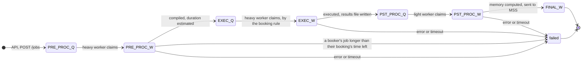
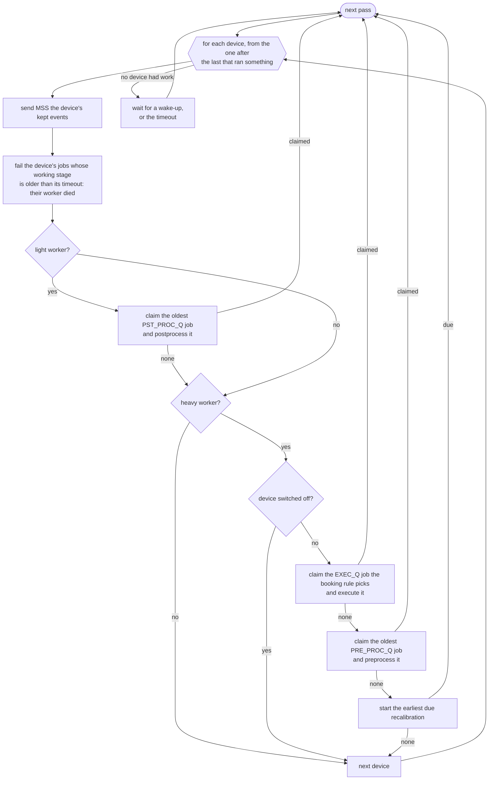
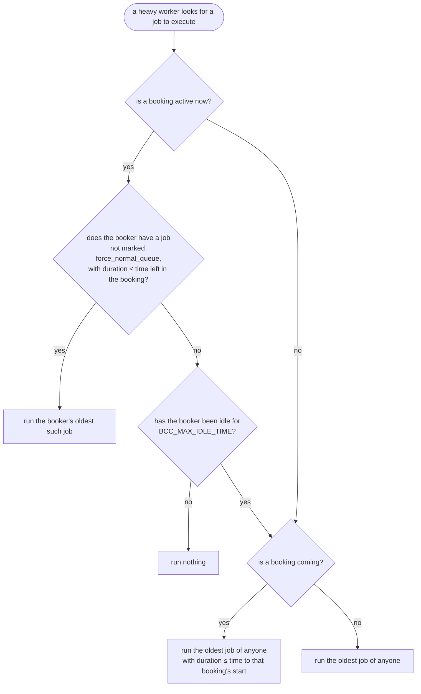
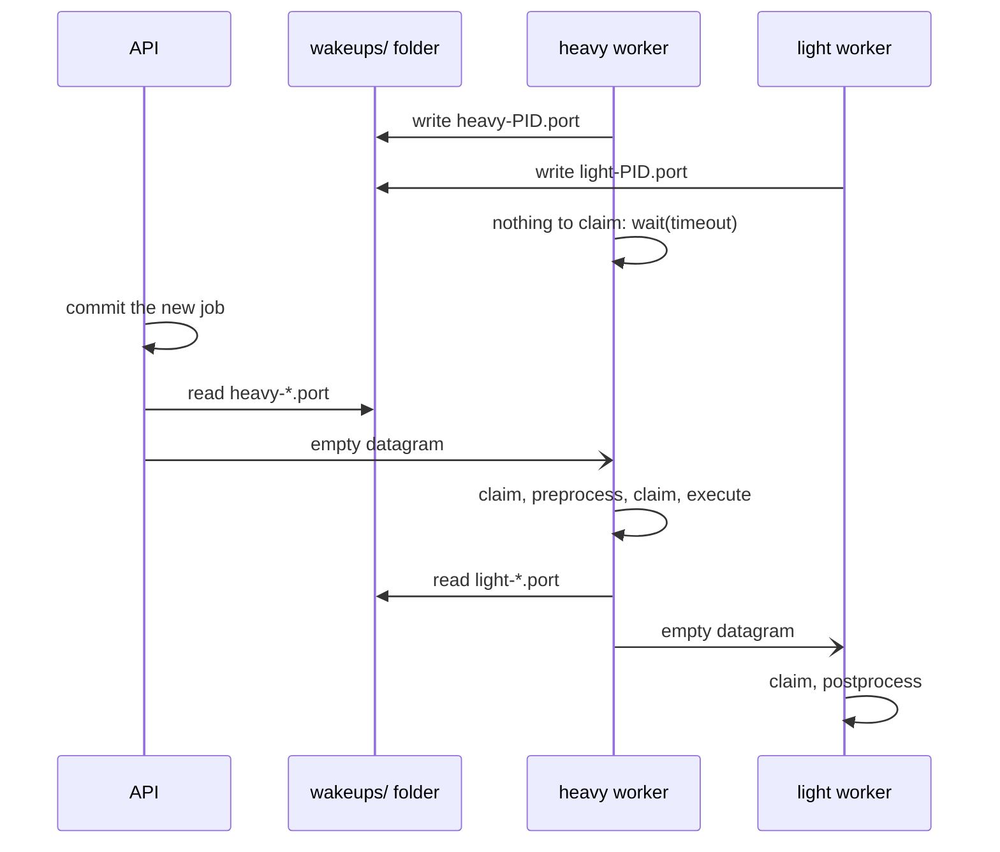

# The dispatcher: how jobs move through the workers

This page is for contributors who change how jobs are scheduled. The booking rules as users
see them are in [booking_and_queuing.md](booking_and_queuing.md). The code is
`services/scheduler/dispatcher.py`.

BCC has no queue. Each job is a row in the SQL `job` table. When a worker is free, it queries
that table to decide what to run next, with the booking rules written into the query. A
first-in-first-out queue cannot express a rule like "the booker's oldest job that fits in what
is left of their booking", which is why the RQ queues were replaced.

## A job's stages

Each stage has a queued step (`_Q`) and a working step (`_W`). A worker *claims* a job by
moving it from the queued step to the working step.

| Stage | Status MSS sees | What happens |
| --- | --- | --- |
| `PRE_PROC_Q` | `pending` | The API inserts the job and wakes the device's heavy worker. |
| `PRE_PROC_W` | `executing` | A heavy worker compiles the job and records `estimated_duration`. |
| `EXEC_Q` | `pending` | The job waits for the booking rule to pick it. |
| `EXEC_W` | `executing` | A heavy worker runs the job on the instruments or the simulated chip. |
| `PST_PROC_Q` | `executing` | The results file is written; the heavy worker wakes the light workers. |
| `PST_PROC_W` | `executing`, then `successful` | A light worker computes the memory, marks the job `successful` and sends it to MSS. |
| `FINAL_W` | `successful` | The light worker sends MSS the final job. |

- The job's row holds the job as JSON (`data`) and the columns the dispatcher queries:
  `stage`, `status`, `user_id`, `created_at`, `estimated_duration`, `claimed_at`,
  `executed_at`, `is_booking_excluded` and `results_file`.
- A job that fails at any stage is marked `failed` with its reason, logged to the job
  supervisor log and sent to MSS.
- MSS hears about a job only when it fails, when it gets its results and at `FINAL_W`. The
  stages in between are not reported.
- `REG_Q` and `REG_W` are no longer used.

## A worker's loop

`Dispatcher.run` loops over the worker's devices. On each pass it looks for work on each
device in turn, and starts the next pass from the device after the last one that ran
something, so a light worker serves every device fairly. It waits only when no device had
anything to do.

A heavy worker's priorities are: execute, then preprocess, then recalibrate. A recalibration
runs only when the device has nothing to execute or preprocess. While a device is switched
off, its heavy work stops, but its jobs still postprocess.

### Claiming a job

A claim is one transaction (`_claim_job`): pick the row, set its `stage` to the working step
and `claimed_at` to now, commit. The worker then runs the stage outside the transaction.

Two workers never claim the same row:

- On SQLite, `open_immediate_session` starts the transaction with `BEGIN IMMEDIATE`, which
  takes the write lock.
- On PostgreSQL, the query uses `SELECT … FOR UPDATE SKIP LOCKED`.

## Which job executes next

`_pick_next_execution` chooses among the device's `EXEC_Q` jobs that are not cancelled or
failed, oldest first. Every one of them has an `estimated_duration` from preprocessing.

- **Idle** counts from the later of the booking's start and the end of the booker's last
  execution in it (`executed_at`). The booker is never idle while one of their jobs executes.
- **Other users' jobs during a booking** run one at a time once the booker is idle. Each must
  end before the *next* booking starts, not before the current one ends. One that is already
  running when the booker submits again runs to completion.
- **Outside bookings**, a job longer than the time to the next booking waits, and shorter,
  newer jobs overtake it. Nothing ages a waiting job, so it can wait until
  `BCC_MAX_EXECUTION_QUEUE_TIME` fails it.
- **`force_normal_queue=true`** on `POST /jobs` sets `is_booking_excluded`: the booker's job
  is treated like anyone else's.
- **Too long for the booking.** When preprocessing ends (`mark_preprocessed`), a job of the
  active booker, not marked `force_normal_queue`, that is longer than the booking's time left
  fails at once. The booker can then book longer or resubmit with `force_normal_queue`. A job
  preprocessed before the booking starts is not checked; if it does not fit, it waits.
- A job still running when its booking ends runs to completion.

## Waking the workers

A worker with nothing to do blocks in `WakeUpListener.wait(timeout)`: a `select` on a UDP
socket bound to a free loopback port. The worker writes that port to
`<storage root>/<device>/wakeups/<kind>-<pid>.port`. Whoever adds work reads the port files
and sends each worker an empty datagram, always after committing the change. The worker
drains every datagram that arrived, so a burst of wake-ups costs one pass.

| Event | Sender | Wakes |
| --- | --- | --- |
| a job submitted | API | heavy |
| a booking created or cancelled | API | heavy |
| a user's profile deleted, cancelling their jobs and bookings | API | heavy |
| a recalibration scheduled | API | heavy |
| a device switched on | API | heavy |
| a job executed | heavy worker | light |

Cancelling a job wakes no one, because it adds no work.

### The wait's timeout

Nothing sends a datagram when time passes, so each worker computes its own timeout
(`Dispatcher._get_wait_seconds`):

- A **light worker** waits at most `BCC_MAX_WORKER_WAIT_TIME` (5 s by default).
- A **heavy worker** with a job in `EXEC_Q` wakes at the next moment the booking rule could
  pick a different job: the active booking's end, the booker turning idle, or the next
  booking's start (`get_next_change_at`). It still waits at most `BCC_MAX_WORKER_WAIT_TIME`.

That cap also bounds everything nothing announces: a due recalibration, a dead worker's job
reaching its timeout, and a lost datagram.

A starting worker deletes the port files of dead processes; a stopping one deletes its own.
`Dispatcher.stop`, called on SIGTERM, sends the worker a datagram so it stops after the
current stage instead of waiting out its timeout.

## Timeouts and stuck processes

| Problem | What catches it |
| --- | --- |
| A stage runs too long | A `SIGALRM` timer of `BCC_MAX_PREPROCESSING_TIME`, `BCC_MAX_EXECUTION_TIME` or `BCC_MAX_POSTPROCESSING_TIME` fails the job. 0 means no limit. |
| A worker is stuck in a call that never returns, so `SIGALRM` never fires | `bcc start` kills the worker when it passes its deadline. |
| The API's event loop hangs | `bcc start` kills the API after 3 missed `/health` checks in a row. |
| `bcc start` itself hangs | systemd's watchdog (`WatchdogSec=60s` in `bcc@.service`) restarts it. |
| A worker died mid-stage | The next pass of any worker fails the job once its working stage is older than that stage's limit (`fail_overdue_jobs`). |
| A job waits in `EXEC_Q` too long | Each pass fails jobs older than `BCC_MAX_EXECUTION_QUEUE_TIME` (a day by default; `fail_jobs_queued_too_long`). |

### Worker deadlines

Each worker keeps a deadline in shared memory (`WorkerDeadline`), and `bcc start` checks it
every 5 s (`DEADLINE_CHECK_SECONDS` in `main.py`). The worker moves its deadline as it goes:

- before a stage: the stage's time limit, plus `BCC_MSS_RESPONSE_TIMEOUT` to tell MSS, plus a
  minute; no deadline for a stage without a limit;
- at the start of a pass: `BCC_MSS_RESPONSE_TIMEOUT` plus a minute;
- before a wait: the wait plus a minute;
- before its first pass, while it connects to the clusters: `BCC_MAX_WORKER_START_TIME`
  (10 minutes by default).

A worker past its deadline is killed with `SIGKILL`, since its `SIGTERM` handler could not
run. `bcc start` then stops the other processes and the service manager restarts the whole
backend. The killed worker's job is later failed as overdue.

`bcc start` notifies systemd's watchdog (`WATCHDOG=1`, in `utils/systemd.py`) only when every
child is on time. A worker run alone as a unit's main process notifies the watchdog itself,
from a thread, while its deadline holds.

## Cancelling and deleting a job

- **Cancelling** sets the job's status to `cancelled`, which every claim's query excludes. A
  stage already running finishes; an execution's results are then dropped, so the job never
  reaches postprocessing.
- **Ending is final.** `JobsStore.mark_ended` writes `successful`, `failed` or `cancelled`
  only to a job that has not ended, checking in the transaction that writes, and
  `JobsStore.update` keeps an ended job's status. So a cancel, a stage's end and a sweep of
  overdue jobs cannot overwrite one another, and MSS hears of a job's end once.
- **Deleting** cancels the job if it has not ended, then deletes its row. A worker that
  finds the job of its stage deleted drops it and goes on.
- **Expiry**: a job's row is deleted `BCC_JOBS_STORE_TTL` seconds after it was last written,
  when another job is inserted.

## Recalibration

A recalibration is a row of the `recalibration` table: `scheduled` with a `due_at`, then
`started`, then `finished` or `failed`.

- **Scheduling** one replaces the device's scheduled rows and stops the running one from
  repeating. The new row is due now unless given a time, and repeats every
  `BCC_DEFAULT_RECALIBRATION_INTERVAL` unless given an interval. The API schedules one at
  every start.
- **Running**: a heavy worker starts the earliest due row and inserts the next one an
  interval later, in one transaction. It runs under the executor lock and
  `BCC_MAX_RECALIBRATION_QUEUE_TIME`.
- **The result** is saved as the device's calibration, sent to MSS as `recalibrated`, and
  written to the calibration seed file so a restart keeps it. Later jobs use its frequencies,
  and the light workers discriminate with it.
- **Abandoned rows**: a starting heavy worker fails rows left `started` by a worker that
  stopped (`fail_abandoned_recalibrations`), unless another heavy worker holds the executor
  lock.

## The executor lock

A file lock in the device's `executor_data` folder. It keeps a device's preprocessing,
executions and recalibrations from running at the same time on its instruments, in case two
heavy workers serve the same device.
