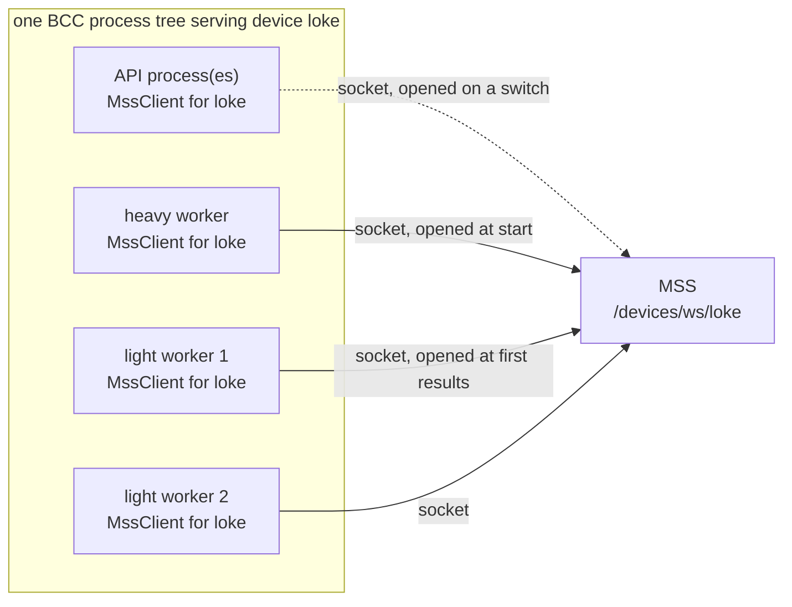
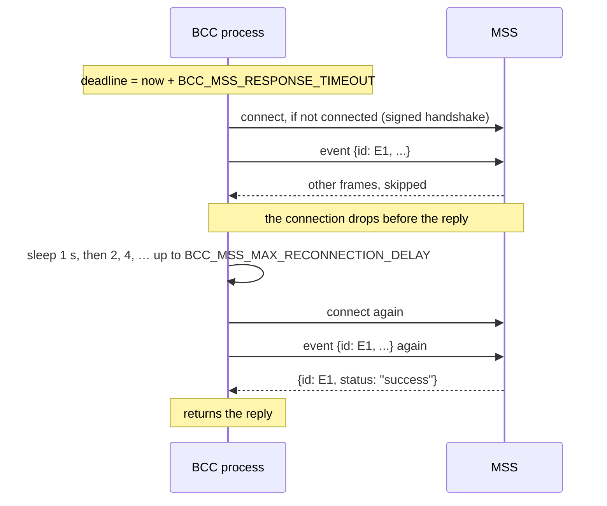
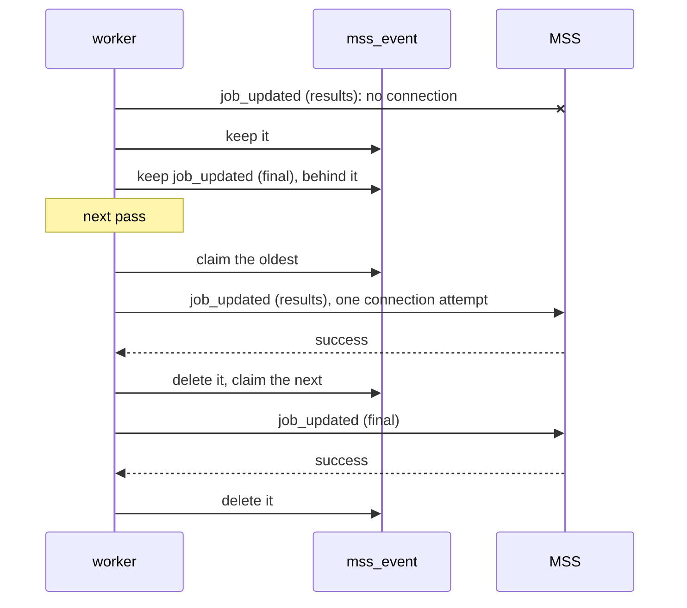

# Talking to MSS

BCC and MSS talk over two channels, one in each direction:

- **MSS → BCC**: signed HTTP calls. See [auth.md](auth.md).
- **BCC → MSS**: events over a websocket of MSS's, `/devices/ws/{device}`. This page
  describes them. The code is in `services/external/mss/`.

MSS keeps users, projects, QPU seconds and the job's record. BCC keeps the bookings, its own
copy of the users who have booked or submitted, the jobs it runs and the device's parameters.

## The events

Each event is one JSON text frame:

```json
{"id": "<uuid>", "name": "<event>", "data": { ... }}
```

MSS answers each one with:

```json
{"id": "<the event's id>", "status": "success" | "error", "detail": "<reason>"}
```

A frame that fails MSS's validation, or names another device's record, gets an `error` reply.
The socket stays open.

| Event | `data` | Sent by | When |
| --- | --- | --- | --- |
| `initialized` | `Device`: the device's properties, with the `pulse_limits` of a device that takes pulse-level jobs | heavy worker | at start, after loading the executor |
| `recalibrated` | `DeviceCalibration`, with the frames and `defcal`s of a device that takes pulse-level jobs | heavy worker | at start, right after `initialized`; after each recalibration |
| `job_updated` | `Job`, whole | the worker running the job | when it fails; when it gets its results; at `FINAL_W` |
| `switched_off` | `{"date"}` | API | on `POST /switch/off` |
| `switched_on` | `{"date"}` | API | on `POST /switch/on` |

MSS never sends requests on the socket. It only answers BCC's events.

## The connections



- **One socket per device per process.** The API (each of its processes), the heavy worker
  and every light worker each hold their own `MssClient` and socket for a device. MSS keeps
  them all; they do not displace each other.
- **Opened lazily**, on the first event. The library pings every 20 s and drops a connection
  whose ping goes unanswered for 20 s. The next event reconnects.
- **The URL** is `BCC_MSS_DEVICE_EVENTS_ENDPOINT`. By default it is `ws://` (or `wss://` for an
  `https` MSS) on the host and port of `BCC_MSS_MACHINE_ROOT_URL`, path `/devices/ws/<prefix>`.
- **The handshake is signed** with BCC's private key (`BCC_PRIVATE_KEY_FILE`). See
  [auth.md](auth.md#how-mss-authenticates-bccs) for the headers and what MSS checks. A
  refused handshake counts as a failed connection attempt.
- **Online and offline.** MSS shows a device as online while any of its sockets is live and
  it is not switched off. A process that dies without closing its sockets leaves the device
  offline within 90 s. See tergite-frontend's DESIGN.md.

## Sending an event

`MssClient.send_event` sends an event and waits for its reply as one operation. If the
connection drops before the reply, it reconnects and sends the same event again.



| Setting | Default | Meaning |
| --- | --- | --- |
| `BCC_MSS_RESPONSE_TIMEOUT` | 120 s | Deadline for the whole operation, retries included. |
| `BCC_MSS_CONNECTION_MAX_ATTEMPTS` | 5 | Reconnections allowed per event, after the first attempt. |
| `BCC_MSS_CONNECTION_TIMEOUT` | 5 s | Time to open one connection. |
| `BCC_MSS_MAX_RECONNECTION_DELAY` | 60 s | Longest sleep between reconnections. |

- **Errors**: past the deadline or out of attempts, `MssTimeoutError`. A reply whose status
  is not `success`, `MssRejectedError`.
- **At least once.** If MSS handled an event but its reply was lost, BCC sends it again with
  the same id. Each event carries the whole job, device or calibration, so handling it twice
  leaves the same state.
- **Order** is kept within a process, which sends one event at a time. There is no order
  across processes.
- **Blocking.** The sending worker or route waits for the reply, up to the deadline.

## When MSS cannot be reached

Neither a job nor a worker depends on MSS answering (`send_mss_event`, in
`services/external/mss/events.py`):

- An event that runs out of time or attempts is **kept** as a row of the `mss_event` table,
  and the worker carries on.
- While a device has kept events, new ones are kept **behind them** without being sent, so
  MSS gets the device's events in order.
- **Each pass of a worker's loop** sends its devices' kept events first, oldest first, with a
  single connection attempt. After a failure it waits `BCC_MSS_MAX_RECONNECTION_DELAY` before
  trying again. A process claims an event while it sends it, so two processes never send the
  same one; a claim older than twice `BCC_MSS_RESPONSE_TIMEOUT` lapses.
- An event MSS **refuses** is logged and dropped: sending it again would not change MSS's
  answer.
- A **switch** is the exception. The API sends it directly, since it is answering MSS's own
  call. The switch is still recorded, and the route answers 504.



## Changing an event's schema

`dev/openapi/openapi.json` publishes the events (`DeviceEvent`, with what each one carries)
and MSS's `EventResponse`. MSS and the SDK generate their models from it, so it is a
contract:

- **Nothing undeclared is sent.** The device, calibration and job models declare every field
  they send and drop any other. A test fails if an event's schema allows undeclared fields.
- **Changes are additive.** A new field is optional with a default, so an MSS without it
  ignores it and an older BCC without it is still read. A field is never renamed, retyped or
  removed in one release: it is deprecated for one release first.
- **In order**: add the field here and in the spec; then MSS copies the spec
  (`dev/openapi/sync.sh`), regenerates its models and stores the field; then the SDK
  regenerates its models.
